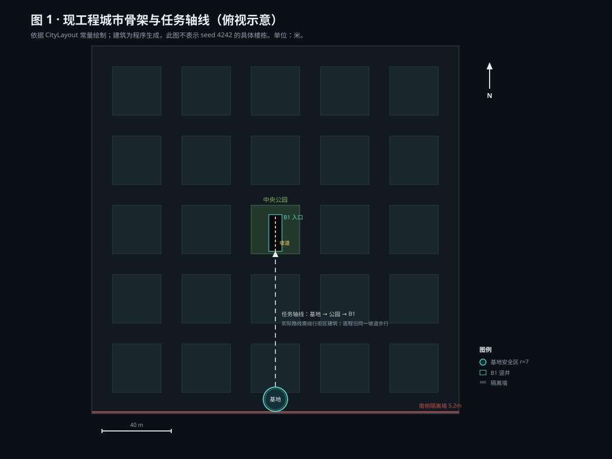
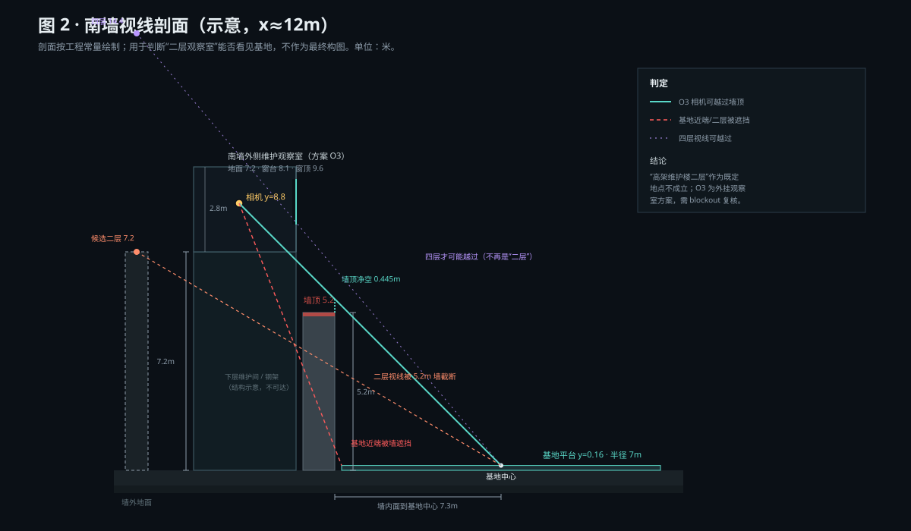

# B · 首章场景定位论证

> 工程基线：`c805ed5ff04ab56381cd36fe5b2e803164750cba`（`main`）  
> 引擎：Godot 4.7.2 stable（Forward+）  
> 性质：只读审计 + 空间论证，不改生产工程。  
> 结论日期：2026-10-24。

## 0. 结论先行

1. **“桥下基地”不是现工程的既定地理。** 基地是南侧隔离墙内侧的一块**开放圆形平台**，中心 `(0, 0.16, -98)`、半径 7m；平台南缘距墙内面仅约 **0.3m**。工程中没有桥、没有高架、没有跨越基地的结构。若菜单 CG 把基地画成“桥下”，会与玩家实际出生的空间直接矛盾。
2. **“地下 B1”是既定事实。** B1 位于 `y=-14`，主厅约 23.6×23.6m，3 个核心台；坡道从公园地面 `z=12.6` 下到 `z=-8.2`，出口踏板在 `z=-9.6`，**没有传送**，返程走同一坡道。
3. **“旧城区高架交通维护楼二层观察室”不是既定地点。** 工程中没有高架、没有交通维护楼、没有二层室内、没有“旧城区”这个命名。它只能作为**新设的菜单专用叙事布景**候选，不能写成正史。
4. **该候选按字面不成立。** 二层（视线高约 7.2m）位于南墙外侧时，看向基地中心的视线会被 5.2m 墙顶截断；要越过墙顶，视线高需约 **10.2m 以上**，那已经不是“二层”。它还需要一条工程中不存在的高架，属于新增地图元素，不是“只做菜单背景”。
5. **可条件接受的是 O3：南墙外侧维护观察室。** 保留“二层观察”的叙事功能，改用工程中唯一真实存在的高差——南侧 5.2m 隔离墙；观察室挂在外侧，地面 7.2m、相机视高 8.8m，看向基地中心的视线在墙顶上方约 **0.445m** 通过。基地近端会被墙遮挡，这是构图可接受的代价。它仍不是可玩正史，必须先过“不改任务、不进可玩路线”的门。
6. **正史安全回退是 O5：不建新建筑，直接把固定相机放在现有南墙/基地轴线上。** 叙事张力弱一些，但零新增地理、零连续性风险。

一句话：**“桥下基地”应删除；“高架二层”应降级为未成立的候选；O3 是当前唯一同时满足“可建模、可编辑、不挡任务、能看见基地与城市”的方案，但必须标注为菜单专用布景。**

---

## 1. 范围与方法

### 1.1 本文件回答什么

- 第一章现有玩法里，基地、B1、任务出口、城市空间到底是什么关系；
- “桥下基地”“高架交通维护楼二层观察室”能否被工程证据支持；
- 如果要做叙事驱动的菜单 CG，哪个地点在**空间上**成立、需要什么条件；
- 哪些内容只能标记为待补证，不能写成剧情设定。

### 1.2 不回答什么

- 不写第一章剧本、角色、台词、任务动机；
- 不改任务逻辑、碰撞、出生点、网络同步；
- 不做最终构图、材质、灯光（这些在 C、D 文档）；
- 不把任何 AI 合成图当作场景证据。

### 1.3 证据等级

沿用阶段一：

| 等级 | 含义 | 本文件用法 |
|---|---|---|
| `STATIC_VERIFIED` | 直接来自工程源码/常量，可复读 | 坐标、尺寸、任务文本、缺失项 |
| `HARNESS_VERIFIED` | 由工程脚本在引擎里实际生成/测量 | 布局快照、尺寸测量 |
| `UNVERIFIED` | 尚未运行或无法从代码确认 | 相机实拍、最终视线、性能 |
| `NOT FOUND` | 在工程范围内检索不到 | 桥、高架、章节、观察室 |
| `DESIGN HYPOTHESIS` | 本轮提出的设计判断，需评审 | O3 方案、构图、叙事框架 |

### 1.4 实际检索

- 全工程 `.gd/.tscn/.tres/.md` 检索 `bridge|elevated|flyover|overpass|高架|立交|天桥|观察室|维护楼|交通`：**0 命中**。
- 检索 `chapter|章节|剧情|叙事|story|narrative`：只命中 `meta_profile.gd` 的 `history`（行动历史），**没有章节/剧情系统**。
- 读取 `city_layout.gd`、`city_builder.gd`、`mission_site.gd`、`main.gd`、`main_menu.gd`、`menu_backdrop.gd`。
- 使用 `ui_refactor/phase2/tools/dump_layout.gd` 生成 `layout_4242.json` 作为 seed 4242 的快照；该快照只用于观察街区尺度，**不作为所有随机种子的代表**。本轮结论主要依赖常量，不依赖该快照。

---

## 2. “首章”在现工程里指什么

工程没有章节、关卡、剧情状态机。`main.gd` 的流程是：

```text
主菜单 → 创建/加入/单人 → 大厅准备 → 生成城市与任务点 → 出生在基地 → 
沿城市进入中央公园 → 下坡道到 B1 → 回收 3 个核心 → 步行返回基地 → 结算
```

因此本文件把“首章”定义为：

> **当前版本的第一段可玩部署循环（first deployment loop）**：从南侧基地出发，穿过随机城市，进入中央公园下的 B1，回收 3 个核心，再沿原坡道返回基地。

这是一个**设计定义**，不是剧情正史。它只用于限定菜单 CG 能引用哪些空间，不新增任何剧情。

证据：

- `scripts/main.gd:54-55`：初始任务提示为“沿市中心公园坡道下到核心储藏层 B1”“基地安全区”。
- `scripts/main.gd:609-655`：`_prepare_world()` 生成城市、任务点、HUD，并设置任务文案。
- `scripts/mission_site.gd:19-22`：3 个核心点。
- `scripts/main.gd` 的 `_server_secure_core`：必须在安全区且靠近交付台才能交付；第 3 个核心触发胜利。
- `scripts/mission_site.gd` 的出口踏板只标记“上行坡道 · 返回地表”，没有传送逻辑。

---

## 3. 已核实的空间事实

### 3.1 城市骨架

`CityLayout.generate()` 的默认参数：`grid_size=5`、`block_size=28`、`road_width=12`。

```text
pitch      = 28 + 12 = 40
total_size = 5 × 40 + 12 = 212m
origin     = -106m
道路中心   = -100, -60, -20, 20, 60, 100
街区中心   = -80, -40, 0, 40, 80（x、z 同）
中央街区   = (0, 0)，强制为公园
```

证据：`scripts/city_layout.gd:26-27`、`:48-49`。  
边界墙：高 5.2m、厚 1.4m，位于 `±106m`；南墙内面为 `z=-105.3`。证据：`scripts/city_builder.gd:457-469`。

### 3.2 基地

```gdscript
const BASE_CENTER := Vector3(0.0, 0.16, -98.0)
const SAFE_RADIUS := 7.0
const CONSOLE_POINT := Vector3(0.0, 0.16, -101.4)
const AMMO_POINT := Vector3(-4.6, 0.16, -94.6)
```

证据：`scripts/mission_site.gd:4-7`。

空间含义：

- 基地中心在**南侧外围道路**上，不是街区内部，也不是桥下；
- 平台南缘 `z=-105.0`，墙内面 `z=-105.3`，两者仅差 **0.3m**，平台几乎是贴着墙的；
- 基地北缘 `z=-91.0`，到中央公园南缘 `z=-14` 还有约 77m 的城市街区；
- 基地是开放圆形平台，没有屋顶、没有上方结构；`_build_base()` 只生成平台、内圈、环、12 条刻线、4 根灯柱、交付台、弹药台、箱子与 Label3D。

### 3.3 B1、坡道、出口

```gdscript
const BASEMENT_Y := -14.0
const BASEMENT_EXIT := Vector3(0.0, -13.84, -9.6)
const RAMP_TOP := Vector3(0.0, 0.18, 12.6)
const RAMP_BOTTOM := Vector3(0.0, -14.0, -8.2)
const RAMP_ANGLE := 0.5985
const HOLE_MIN := Vector2(-3.8, -8.6)
const HOLE_MAX := Vector2(3.8, 12.6)
```

证据：`scripts/mission_site.gd:10-17`；竖井矩形在 `city_builder.gd:12`。

- 竖井开在中央公园：x `-3.8..3.8`，z `-8.6..12.6`；
- 坡道从公园地面 `z=12.6` 向南下到 `z=-8.2`，高差 14.18m；`RAMP_ANGLE=0.5985 rad ≈ 34.3°`；
- B1 地板 `y=-14.25`，主厅 23.6×23.6m；3 个核心台在 `(-4.6,0.6)`、`(4.6,0.6)`、`(-7.2,-9.4)`；
- 出口踏板 `(0,-13.84,-9.6)` 就在坡道底端旁，标签“上行坡道 · 返回地表”；
- **没有第二个出口、没有传送、没有电梯**；任务文案明确“回收全部核心后步行返回基地”，世界标签写“无传送 · 步行通道”。

### 3.4 菜单现状

- 主菜单是 `Control`，背景是 `MenuBackdrop`（2D 自绘夜景），不是 3D 场景；证据：`scripts/main_menu.gd:53-56`。
- `MenuBackdrop` 每帧 `queue_redraw()`，且没有可见性判断；菜单在游戏中被隐藏但仍在树里。证据：`scripts/menu_backdrop.gd:50-60`。
- 当前菜单两列几乎占满全宽：外边距 62/62/34/26，列间距 38，右栏最小 352；证据：`scripts/main_menu.gd:58-70,159`。
- 这正是阶段一测得“最小高 741 > 720”的结构原因；换成 CG 背景不会自动修好它，反而会挤压可视区。

---

## 4. 逐条判定

| 说法 | 判定 | 证据 / 理由 | 对菜单 CG 的后果 |
|---|---|---|---|
| “桥下基地” | **REJECTED / NOT FOUND** | 基地是开放圆台，贴南墙；全工程无桥/高架几何 | 不能画 overhead bridge；会与出生点矛盾 |
| “地下 B1 是核心储藏层” | **VERIFIED** | `mission_site.gd:10-24`；B1 主厅与 3 核心台 | 可作为远景/叙事目的地，但距离 100m+ |
| “任务出口在 B1 另一侧” | **REJECTED** | `BASEMENT_EXIT` 在坡道底端；只有一条坡道 | 不能画第二条出口/传送门 |
| “基地—B1 可传送” | **REJECTED** | 标签“无传送 · 步行通道”；任务要求步行返回 | 不能画传送光柱作为主叙事 |
| “高架交通维护楼” | **NOT FOUND** | 无高架、无交通设施、无维护楼 | 只能新建，属于新增地图元素 |
| “二层观察室” | **NOT FOUND** | 可进入建筑都是单层房间壳；无二层室内 | 只能新建菜单专用布景 |
| “旧城区” | **NOT FOUND** | 只有 downtown/industrial/residential 三种程序化分区 | 不能把“旧城区”写成既定地名 |
| “首章剧情” | **NOT FOUND** | 无章节/剧情系统；只有行动历史 | 只能定义为“首次部署循环” |
| “基地在南墙边” | **VERIFIED** | 基地南缘 z=-105.0，墙内面 z=-105.3 | 可作为观察室的真实空间锚点 |

---

## 5. 空间论证

### 5.1 俯视关系



要点：

- 基地在南侧外围道路，贴着南墙；城市在它北面展开；
- 中央公园 `(0,0)` 是唯一强制公园街区，B1 竖井在其中；
- 任务轴线是南北向，但**不是一条直线通道**：基地到公园之间隔着 5 个街区，玩家需要沿道路绕行建筑；
- 因此菜单 CG 若从南墙斜看向北，能同时看到“近处基地 + 中景街区 + 远处公园/B1 微光”，空间关系是真实的；
- 若从基地正后方（正南）平视，墙会挡住城市；若从正上方俯视，又像战术地图，不像叙事镜头。**斜向越墙**是唯一同时保留基地与城市纵深的方向。

### 5.2 南墙视线剖面



以候选 O3 的相机 `C=(12.0, 8.8, -109.5)` 为例：

- 墙内面 `z=-105.3`，墙顶 `y=5.2`；
- 基地中心 `B=(0, 0.16, -98)`；
- 相机到基地中心的连线在墙面的参数：

```text
t = (-105.3 - (-109.5)) / (-98 - (-109.5))
  = 4.2 / 11.5
  = 0.3652

y_wall = 8.8 + (0.16 - 8.8) × 0.3652
       = 8.8 - 3.155
       = 5.645m
```

`5.645 > 5.2`，**墙顶净空约 0.445m**。这意味着：

- 基地中心、交付台、北半部可见；
- 基地南缘（贴墙的一圈）会被墙顶遮住；这是可接受的“前景遮挡”，不是错误；
- 如果相机降到 7.2m（字面上的“二层”），同一位置 `y_wall ≈ 4.0m`，**被墙截断**；
- 如果观察室退到墙外更远（例如 `z=-114`），二层视线更被挡；要让二层越过 5.2m 墙，需要把观察室抬到约 **10.2m 以上**，或者把墙降低/开缺口——两者都会改动现工程。

因此：“高架维护楼二层”按字面不成立；O3 的 8.8m 视高是**为了越墙而付出的高度**，它已经不是普通二层，而是“贴墙外挂的二层观察室 + 抬高基座”。这一点必须在 CG 设定里说清楚，不能伪装成普通二层。

### 5.3 候选矩阵

评分 1–5，5 最好；“成本”5 表示最省。

| 方案 | 正史一致性 | 视线 | 可建模 | 对玩法影响 | 叙事价值 | 成本 | 结论 |
|---|---:|---:|---:|---:|---:|---:|---|
| O1 桥下基地 | 1 | 2 | 3 | 2 | 4 | 3 | **拒绝**：工程无桥，直接矛盾 |
| O2 高架交通维护楼二层（字面） | 1 | 1 | 2 | 1 | 5 | 1 | **拒绝**：需新增高架；二层被墙挡 |
| O3 南墙外侧维护观察室（8.8m 视高） | 4 | 4 | 5 | 5 | 4 | 4 | **条件接受**：菜单专用布景 |
| O4 南墙顶观察位（无室内） | 5 | 4 | 5 | 5 | 3 | 5 | 备选：最省，但叙事弱 |
| O5 现有基地/公园轴线固定相机 | 5 | 3 | 5 | 5 | 3 | 5 | **正史安全回退**：不建新建筑 |

### 5.4 判定与条件

**判定：**

- **O1 删除**，不得在任何菜单文案/设定中写“桥下基地”。
- **O2 不作为既定地点**；如果叙事负责人坚持“高架”，那是一次**新增地图元素**的设计，需要单独的关卡、碰撞、视线与性能评审，不能用“菜单 CG”绕过。
- **O3 作为首选制作方案**，但必须满足以下条件：
  1. 只存在于菜单 CG / 菜单专用场景，不进入可玩地图，不加碰撞，不改出生点与任务点；
  2. 不改变南墙、基地、坡道、B1 的任何几何；
  3. 观察室是“贴墙外挂”的维护舱，不是高架桥；不在游戏内出现“高架”字样；
  4. 若未来要把它加进游戏世界，必须另立变更，先做从基地看墙角的实拍对比、碰撞与性能评审；
  5. 不新增“旧城区”地名；如剧情需要，只能作为**菜单旁白/UI 文案**，并先由叙事负责人确认；
  6. 所有镜头参数在 Blender blockout 中复核；本文件的 8.8m / 24mm 是**设计假设**，不是已验收结果。

**为什么不是 O5：** O5 最安全，但它只是“把现有基地拍得更电影化”，很难承载“叙事驱动的 CG 主菜单”这一新决定。O3 用最小新增（一个外挂维护舱）换到“观察者视角”，同时不碰可玩空间，是当前性价比最高的折中。

**为什么不是 O1/O2：** 它们不是“美术风格问题”，而是**空间事实问题**。一旦画进菜单，玩家进入游戏就会看到基地上方没有桥、墙外没有高架，信任感直接崩。阶段一已经反复强调“实际工程是唯一工程依据”，这条同样适用于叙事场景。

---

## 6. 叙事框架（待评审）

在不新增剧情正史的前提下，菜单 CG 只能表达“部署前夜”的状态，而不是一段有台词/角色名的过场：

- **地点**：南墙外侧维护观察室；桌上有一张没有可读文字的城区图、一台无线电、一只冷掉的杯子；窗外是基地与城市。
- **时间**：深夜/蓝调时刻；月亮低垂，城市有少量暖窗，基地有青色安全环与琥珀工作灯。
- **关系**：观察室是“看”的位置，基地是“回”的位置，城市/B1 是“去”的位置。三者构成一个静止的叙事三角，不需要人物出场。
- **威胁**：不直接展示丧尸；用雾、远处熄灭的街区、偶尔的红色警示灯暗示。这样既不抢 UI，也不新增敌人设定。
- **文字**：全部由 UI 承担；CG 内**零文字**。桌面纸张只有抽象等高线/色块，不能出现可读字母、数字、品牌。
- **人物**：默认空镜。若未来加剪影，只能是背影/局部，不命名、不露脸，避免与 1–4 人合作角色设定冲突。

以上均为 `DESIGN HYPOTHESIS`，需要叙事/美术负责人确认；本文件不把它写成已定稿剧情。

---

## 7. 待补证清单

| 项 | 状态 | 需要什么 |
|---|---|---|
| 第一章剧本/角色/地名 | `NOT FOUND` | 叙事负责人给出正式设定；否则只能使用“首次部署循环” |
| “旧城区”是否成立 | `NOT FOUND` | 命名与世界观评审 |
| 观察室是否可被接受为“基地附属设施” | `UNVERIFIED` | 美术/关卡评审；从基地看墙角的实拍对比 |
| O3 相机实际画面 | `UNVERIFIED` | Blender blockout 渲染；本轮未做 |
| 墙外维护舱在游戏内是否可见/穿帮 | `UNVERIFIED` | 从基地、出生点、B1 出口三个视角截图 |
| 5.2m 墙顶净空 0.445m 的实拍 | `UNVERIFIED` | 引擎内相机复现；本文件为几何计算 |
| 菜单 CG 的性能/显存 | `UNVERIFIED` | Godot 导入后实测 |
| 4:3 / 超宽支持 | `UNVERIFIED` | 产品确认目标分辨率 |

---

## 8. 本文件没有做的事

- 没有创建任何 `.blend`、模型、材质或渲染图；
- 没有修改 `mission_site.gd`、`city_builder.gd`、`main.gd`、`main_menu.gd`；
- 没有把“桥下基地”“高架维护楼”写成既定剧情；
- 没有用 AI 合成图代替场景证据；
- 没有把 O3 的相机参数当作已验收结果。

---

## 9. 给下一份文档的输入

C（CG 分件与制作方案）将直接使用本文件的以下结论：

- 地点：O3 南墙外侧维护观察室；坐标锚点 `(12.0, 7.2, -109.25)`（房间中心，假设）；
- 相机：视高 8.8m、24mm、目标点 `(-24, 0.8, -30)`；需 blockout 复核；
- 视线：基地中心净空 0.445m；基地近端被墙遮挡；
- 叙事：空镜、无文字、无人物命名、无丧尸直出；
- 边界：菜单专用，不进可玩地图，不改任务几何。

D（双工作线接口）将把“菜单专用”“无文字”“安全区”“回退”写成可执行的资产契约。
