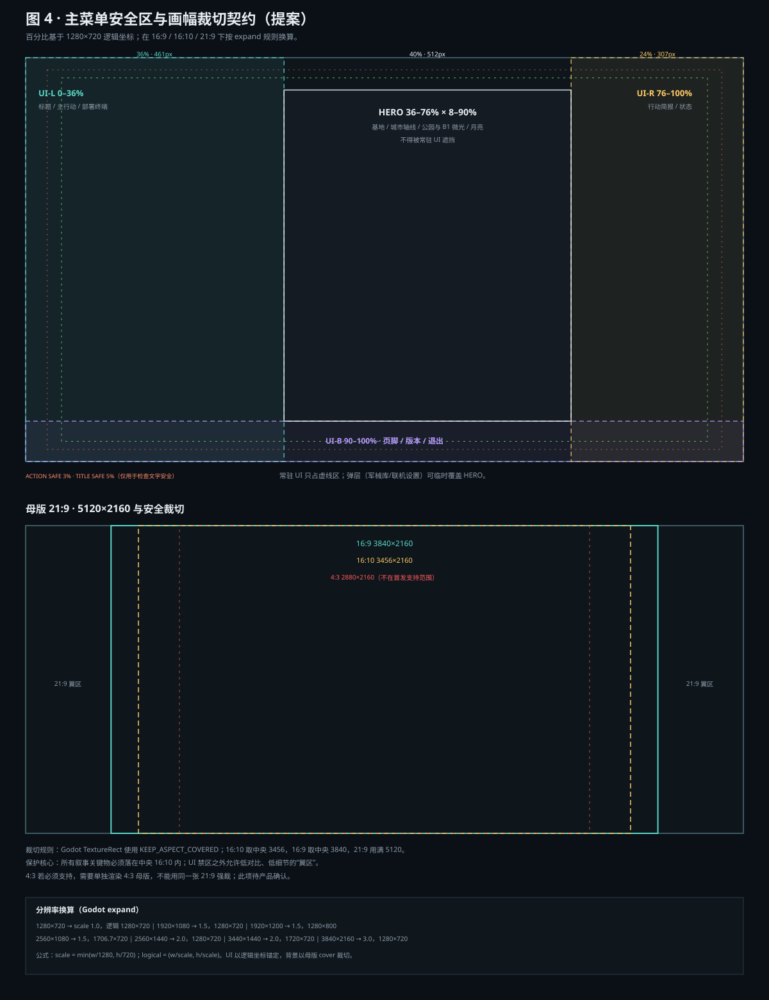

# D · 双工作线接口

> 工作线 A：游戏 UI 系统（布局、焦点、输入、状态）。  
> 工作线 B：主菜单 CG（Blender 场景、渲染、输出）。  
> 本文是两者之间的**资产与运行时契约**，不是美术风格建议。  
> 基线：`c805ed5ff04ab56381cd36fe5b2e803164750cba`。  
> 日期：2026-10-24。

## 1. 契约原则

1. **B 拥有图像，A 拥有 UI。** B 不决定按钮位置；A 不修改 CG 构图。
2. **文字永远在 UI。** CG 内零文字、零按钮、零语言文案；避免本地化/分辨率/可访问性灾难。
3. **单一真相。** 安全区、裁切、色彩、版本由 `menu_bg_contract_v001.json` + `menu_layout_contract_v001.json` 定义；不以聊天记录/口头约定为准。
4. **可回退。** CG 缺失、显存不足、导入失败时，菜单必须退回现有 `MenuBackdrop`，不能崩。
5. **不碰玩法。** CG 不进入可玩地图，不加碰撞，不改任务/出生点/网络。
6. **先冻结，再制作。** A1 线框与 B1 白模对齐后，才允许 B2 最终构图/B3 高模。

---

## 2. B 向 A 交付的文件

| 文件 | 格式 | 规格 | 用途 |
|---|---|---|---|
| `menu_bg_master_21x9_v001.exr` | EXR 16-bit | 5120×2160 | 母版/后续调色，不直接进 Godot |
| `menu_bg_master_21x9_v001.png` | PNG 8-bit sRGB | 5120×2160 | 21:9 直接使用 |
| `menu_bg_16x9_v001.png` | PNG 8-bit sRGB | 3840×2160 | 16:9 主交付 |
| `menu_bg_16x10_v001.png` | PNG 8-bit sRGB | 3456×2160 | 16:10 可选；也可运行时从母版裁 |
| `menu_bg_contract_v001.json` | JSON | 见 §3 | 裁切/安全区/色彩/版本 |
| `menu_bg_safeareas_v001.svg` | SVG | 1280×720 逻辑 | 给 UI/QA 叠加检查 |
| `menu_bg_lut_v001.cube` | Cube LUT | 可选 | 如做统一调色；不用则省略 |
| `menu_cg_v001.blend` + 资产库 | Blend | 可编辑 | 资产归档，不进运行时 |
| `menu_bg_loop_1080p_v001.webm` | WebM | 1920×1080，6s，可选 | 仅当产品确认要动态背景 |

**交付验收：** 所有 PNG 不得含任何可读文字/数字/Logo/UI；EXR 与 PNG 的构图必须一致；文件名含版本；附 SHA256（构建时填写，不预填假值）。

---

## 3. `menu_bg_contract_v001.json` 建议结构

```json
{
  "contract_version": "1.0",
  "asset_version": "menu_bg_v001",
  "master": {
    "file": "menu_bg_master_21x9_v001.png",
    "width": 5120,
    "height": 2160,
    "aspect": 2.370,
    "color_space": "sRGB",
    "text_baked": false
  },
  "crops": {
    "16x9":  { "x": 640, "y": 0, "w": 3840, "h": 2160 },
    "16x10": { "x": 832, "y": 0, "w": 3456, "h": 2160 },
    "21x9":  { "x": 0,   "y": 0, "w": 5120, "h": 2160 }
  },
  "safe_zones": {
    "ui_left":   { "x": 0.00, "y": 0.00, "w": 0.36, "h": 1.00 },
    "ui_right":  { "x": 0.76, "y": 0.00, "w": 0.24, "h": 1.00 },
    "ui_bottom": { "x": 0.00, "y": 0.90, "w": 1.00, "h": 0.10 },
    "hero":      { "x": 0.36, "y": 0.08, "w": 0.40, "h": 0.82 },
    "title_safe": 0.05,
    "action_safe": 0.03
  },
  "camera": {
    "lens_mm": 24,
    "sensor_fit": "VERTICAL",
    "sensor_height_mm": 20.25,
    "position": [12.0, 8.8, -109.5],
    "target": [-24.0, 0.8, -30.0],
    "fov_16x9": [73.7, 45.8],
    "fov_21x9": [90.0, 45.8]
  },
  "color": {
    "view_transform": "AgX",
    "output": "sRGB",
    "exposure": 0.0
  },
  "fallback": "MenuBackdrop",
  "sha256": "<build-time>"
}
```

> `sha256` 必须在最终文件生成后计算；禁止手写/编造。  
> `aspect` 2.370 是 5120/2160 的实际值；产品口语中的“21:9”包含 2.33–2.39 一类。

---

## 4. 画幅与分辨率

### 4.1 Godot 换算

工程设置：`window/stretch/mode="canvas_items"`、`aspect="expand"`、基准 1280×720。证据：`project.godot:21-26`。

```text
scale   = min(window_w / 1280, window_h / 720)
logical = (window_w / scale, window_h / scale)
```

### 4.2 目标矩阵

| 窗口 | 比例 | scale | 逻辑尺寸 | 背景可见裁切 | 说明 |
|---|---:|---:|---|---|---|
| 1280×720 | 16:9 | 1.0 | 1280×720 | 中央 3840×2160 | 基准 |
| 1920×1080 | 16:9 | 1.5 | 1280×720 | 中央 3840×2160 | 主目标 |
| 1920×1200 | 16:10 | 1.5 | 1280×800 | 中央 3456×2160 | 纵向多 80 逻辑 px |
| 2560×1080 | 21:9 类 | 1.5 | 1706.7×720 | 全 5120×2160 | 横向多 426.7 逻辑 px |
| 2560×1440 | 16:9 | 2.0 | 1280×720 | 中央 3840×2160 | 2K |
| 3440×1440 | 21:9 类 | 2.0 | 1720×720 | 约全宽，纵向裁 ≤1% | 21:9 类宽屏 |
| 3840×2160 | 16:9 | 3.0 | 1280×720 | 中央 3840×2160 | 4K |
| 1024×768 | 4:3 | 0.8 | 1280×960 | 中央 2880×2160 | **不在首发支持**，需单独确认 |

### 4.3 裁切规则

- Godot `TextureRect`：`stretch_mode = STRETCH_KEEP_ASPECT_COVERED`；
- 16:9/16:10 从 21:9 母版中央裁，不拉伸；
- 21:9 类宽屏用满母版；3440×1440 可能纵向裁 ≤1%，可接受；
- 4:3 若必须支持，**单独渲染 4:3 母版**，不能用同一张 21:9 强裁；否则左侧标题区/右侧简报区会丢失；
- 所有叙事关键物落在中央 16:10 内；翼区只放低对比、低细节的城市延伸。

---

## 5. 安全区



### 5.1 1280×720 逻辑坐标

| 区域 | 百分比 | 像素（1280×720） | 用途 | CG 规则 |
|---|---|---|---:|---|
| UI-L | x 0–36% | 0–461 | 标题、主行动、部署终端 | 低对比、低细节；允许 scrim |
| UI-R | x 76–100% | 973–1280 | 行动简报、状态 | 低对比；不要放月亮/高亮灯 |
| UI-B | y 90–100% | 648–720 | 页脚、版本、退出 | 暗；不要放关键剪影 |
| HERO | x 36–76%，y 8–90% | 461–973，58–648 | 基地、城市轴线、B1 微光、月亮 | 保护；常驻 UI 不得进入 |
| TITLE SAFE | 5% inset | x 64–1216，y 36–684 | 所有关键文字 | 文字不越线 |
| ACTION SAFE | 3% inset | x 38–1242，y 22–698 | 可点击/可读内容 | 不越线 |

### 5.2 响应式规则

- UI 左右栏以百分比锚定，但设最大宽度；21:9 多出的宽度给 HERO，不把表单拉宽；
- 16:10 多出的 80 逻辑 px 给 HERO 高度；底部栏仍贴底；
- 弹层可以覆盖 HERO，但关闭后必须恢复；常驻 UI 不得压 HERO；
- 标题/正文与 CG 的对比度按**最终合成**测，不只看 CG 亮度；必要处加 scrim/描边，不靠把 CG 压黑。

### 5.3 CG 侧约束

- UI-L/UI-R/UI-B 下方：低频率、低亮度、低细节；不要放高亮窗、红灯、月亮、基地安全环；
- HERO 内：基地/城市/公园/月亮；不要放可读文字；
- 画面边缘：不要放“必须看见”的叙事物；16:10/21:9 裁切会改变边缘；
- 如果 A1 线框调整了安全区，B 必须在 B2 前重出构图；禁止“先渲染再让 UI 躲”。

---

## 6. 色彩管线

```text
Blender Scene Linear
  → AgX（或 Filmic，二选一）
  → 合成/调色
  → sRGB PNG（8-bit）
  → Godot 导入 sRGB
  → 直接显示（不再 gamma）
```

规则：

- 不在 Godot 里对背景做第二次 gamma/对比度调整；UI 的 Theme 颜色独立；
- B 提供一张色卡/灰阶测试渲染（不交付到游戏），A 用同一张图在 Godot 里对比；
- 关键色（青色安全环、琥珀灯、红色警示）不得偏紫/偏绿；红色面积小，避免 UI 抢色；
- LUT 可选；如使用，所有裁切共用同一 LUT，并记录在 contract；
- 暗部保留细节，天空用轻微 dither/grain 防条带；不要把暗部压死，否则 UI 文字对比度会“假高”。

---

## 7. 运行时集成

### 7.1 节点与属性

```text
MainMenu (Control)
├─ MenuBackground (TextureRect)
├─ Scrim (ColorRect / TextureRect)
├─ MenuContent (Control)
└─ Overlays (Control)
```

`MenuBackground`：

```gdscript
expand_mode = TextureRect.EXPAND_IGNORE_SIZE
stretch_mode = TextureRect.STRETCH_KEEP_ASPECT_COVERED
mouse_filter = Control.MOUSE_FILTER_IGNORE
texture_filter = CanvasItem.TEXTURE_FILTER_LINEAR
```

- 全屏锚点；放在 UI 之前；`z_index` 低于内容；
- 不参与 `_process`；静态图不每帧重绘；
- 背景不 `grab_focus()`，不加入 Tab 顺序；
- 如果做落灰/呼吸，用独立 2D 粒子层，位于背景与 `Scrim` 之间；提供“减少动态”。

### 7.2 加载与回退

```text
启动
 ├─ 尝试加载 4K/2K 背景（异步）
 │   ├─ 成功 → 淡入
 │   └─ 失败/超时 → MenuBackdrop（现有 2D 夜景）
 ├─ 显存不足 → 2560×1080
 └─ 导入错误 → MenuBackdrop + 日志
```

- 菜单是首屏，不能因为 4K 图卡住启动；建议先显示低成本占位/纯色，再淡入；
- 回退不弹错误框给玩家；只写日志；
- 回退时 UI 布局保持可用（安全区仍成立）。

### 7.3 显存估算

| 尺寸 | RGBA8 | RGB8 | BC7 近似 |
|---|---:|---:|---:|
| 5120×2160 | 44.2MB | 33.2MB | 11.1MB |
| 3840×2160 | 33.2MB | 24.9MB | 8.3MB |
| 2560×1080 | 11.1MB | 8.3MB | 2.8MB |

未计 mipmap；mipmap 约 +33%。这是估算，B6 必须实测目标机。

### 7.4 显隐策略

| 状态 | 背景 | 处理 |
|---|---|---|
| MENU | 显示 | 正常 |
| DEPLOY_TERMINAL | 显示 | 加 30–50% 暗遮罩 |
| LOBBY | 显示 | 可轻微压暗，保持场景 |
| ARMORY | 显示 | 强遮罩（60–75%）或独立暗底 |
| LOADING | 淡出 | 不参与加载进度 |
| PLAY | 隐藏 | 不渲染、不 `_process` |
| PAUSE | 不显示（菜单不在） | 暂停面板保留游戏场景 |
| RESULT | 可显示暗化背景 | 统计为主 |

---

## 8. 动态策略

- **默认静态。** 一张图 + UI scrim，最稳、最省、最易本地化；
- **可选轻动效。** 引擎侧落灰/灯光呼吸（2D 粒子/着色器），幅度很小；不改变构图；
- **可选 6 秒循环。** 1920×1080 WebM，无缝，无文字；仅在“静态不够”时启用；不作为首发依赖；
- **减少动态。** 系统设置或菜单开关；开启后停止落灰/呼吸；
- **禁止。** 把 UI 文字/按钮烘焙进视频；禁止视频里出现可读招牌。

---

## 9. 版本与变更控制

| 变更 | 谁批准 | 规则 |
|---|---|---|
| B 改构图/安全区 | A + 产品 | 必须重出 contract；A 重新线框/截图 |
| B 改色彩/LUT | A + 美术 | 重新做对比度/色卡；更新 contract |
| A 改菜单布局 | B + 产品 | 先看是否仍在安全区；越界则 B 重构图或 A 回调 |
| A 改 HUD | 不涉及 B | 不影响菜单背景 |
| 紧急回退 | 任一 | 关闭 `ui_v2_menu_background`，回退 `MenuBackdrop` |

版本命名：

```text
menu_bg_master_21x9_v001.png
menu_bg_16x9_v001.png
menu_bg_contract_v001.json
menu_cg_v001.blend
```

不覆盖旧版本；变更递增 `v002`；contract 里记录 `asset_version` 与 `sha256`。

---

## 10. 验收测试

### 10.1 画面/契约

- [ ] 1280×720/1920×1080/1920×1200/2560×1080 四张实机截图；
- [ ] 背景 cover 无拉伸、无黑边、无接缝；
- [ ] HERO 内关键物不被 UI 压；
- [ ] 16:10/21:9 裁切后仍能读出基地/城市/月亮；
- [ ] 无文字（OCR + 人工双检）；
- [ ] 无 UI/按钮/Logo；
- [ ] 与游戏截图的色板/尺度/雾一致；
- [ ] 没有 TLOU 窗户/室内布置/构图复刻。

### 10.2 运行时

- [ ] 缺失背景 → `MenuBackdrop` 回退，不崩；
- [ ] 低显存 → 2560 回退；
- [ ] 背景不拦截鼠标/焦点；
- [ ] 菜单/大厅/军械库/加载/游戏切换正确；
- [ ] 背景不每帧重绘；
- [ ] 加载时间/显存可接受（实测）。

### 10.3 UI 回归

- [ ] 4 人队伍零重叠；
- [ ] 菜单 1280×720 无裁切；
- [ ] 关键文本对比度 ≥4.5:1；
- [ ] 焦点可见、键盘/手柄可达；
- [ ] 状态真实（搬运/空仓/换弹/准备/加载）。

**当前状态：** 以上均为**待执行**；本轮没有 Godot 集成、没有实机截图、没有性能数据。未执行项不得写成“通过”。

---

## 11. 未决问题

1. 菜单采用 A1 的推荐方案 A（主 CTA + 部署终端）还是保守方案 B（常驻表单）？
2. 4:3 是否必须支持？若必须，是否接受单独 4:3 母版？
3. 21:9 的目标是 2560×1080 / 3440×1440 / 两者都要？
4. 静态图是否足够，还是必须 6 秒循环？
5. 叙事负责人是否接受“部署前夜空镜”，不命名角色/地名？
6. 目标 GPU/显存下限？决定 4K 还是 2K 默认。
7. 是否需要多语言安全区复测（中文/英文/日文长度差异）？
8. 是否允许引擎侧落灰？若不允许，CG 内做静态灰，避免动态。

---

## 12. 本文件没有做的事

- 没有创建/修改任何生产脚本、场景、主题、输入配置；
- 没有生成 `.blend`、贴图、渲染图；
- 没有把 `MenuBackground` 接入 `main_menu.gd`；
- 没有实测 4 分辨率、显存、加载时间；
- 没有把未执行项写成已完成。

本文件只定义接口；下一步是 B1 白模 + A1 线框，双方按本契约对齐后再进入 B2/B3。
